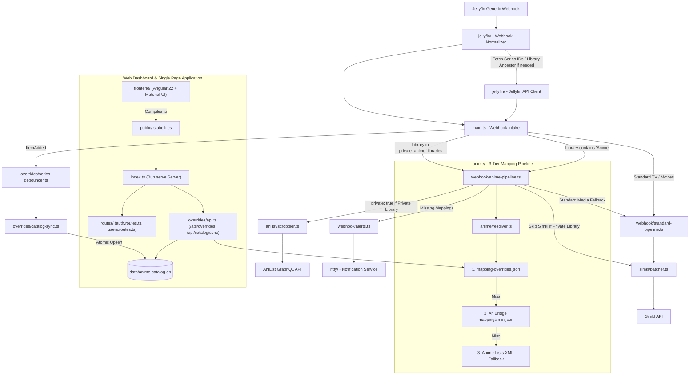

# jellyfin-tracker-sync

A lightweight, high-performance media sync webhook server built in TypeScript with [Bun](https://bun.sh/). It listens directly to Jellyfin playback webhook events, automatically routes between Anime (using AniBridge cross-referencing to AniList with TVDB fallback) and standard TV Shows/Movies (using TVDB, TMDB, and IMDb IDs), and synchronizes watch history to your Simkl and AniList accounts.

It includes a modern **Angular Single-Page Application (SPA)** with Angular Material UI for visual tracker authentication, token health monitoring, and anime mapping overrides management.

---

## 🏛️ Architecture & Core Components



- **[index.ts](./index.ts)**: HTTP server orchestrator using `Bun.serve`. Serves the compiled Angular SPA from `./public`, dispatches API and webhook requests, and coordinates graceful shutdown.
- **[main.ts](./main.ts)**: Webhook intake controller. Normalizes payloads, validates user tokens, inspects library names, checks completion thresholds ($\ge 80\%$), and dispatches to anime vs. standard scrobbling pipelines.
- **[webhook/](./webhook)**:
  - **`anime-pipeline.ts`**: Coordinates anime episode and movie scrobbling to Simkl and AniList, handling specials, standard fallbacks, and private library rules.
  - **`standard-pipeline.ts`**: Queries Jellyfin metadata fallback IDs and enqueues standard TV shows and movies directly to Simkl.
  - **`alerts.ts`**: Manages missing mapping notification cooldowns (1 hour per show) and sends alerts via `ntfy`.
- **[overrides/](./overrides)**:
  - **`catalog-db.ts`**: Fast, embedded SQLite storage engine powered by native `bun:sqlite` in WAL mode (`anime-catalog.db`). Replaces heavy JSON serialization with atomic row-level updates.
  - **`catalog-sync.ts`**: Scans Jellyfin anime libraries, streams additions, and performs mark-and-sweep deletion tracking for deleted files.
  - **`catalog-store.ts`**: Manages disk paths, sparse overrides pruning, and data persistence.
  - **`series-debouncer.ts`**: Real-time continuous sync debouncer triggered when new items are added in Jellyfin.
  - **`api.ts`**: REST endpoints powering the Web UI (`/api/overrides`, `/api/catalog/sync`, `/api/series/sync`, `/api/overrides/retire-redundant`).
- **[frontend/](./frontend)**: Angular 22 Single Page Application built with Angular Material, Signal Store, and modern responsive styles.
- **[anime/](./anime)**: 3-tier anime cross-referencing engine:
  - **1. Overrides** (`mapping-overrides.json`): Sparse user-configured overrides evaluated with top priority.
  - **2. AniBridge** (`mappings.min.json`): Fast, indexed mappings translating TVDB/TMDB seasons into AniList entries with support for continuous seasons, specials, multi-part ratios, and movies.
  - **3. Anime-Lists** (`anime-list-full.xml`): Community XML fallback for unplaced titles.
- **[jellyfin/](./jellyfin)**: Webhook normalizer and lightweight Jellyfin API client with in-memory caching to resolve series IDs and parent collection/library names if missing from the webhook payload.
- **[simkl/](./simkl)**: Simkl API scrobbler with PKCE OAuth 2.0, token management, batch queuing, and retry handling.
- **[anilist/](./anilist)**: AniList GraphQL scrobbler with token management, watch progress debouncing, rate-limit backoff, and privacy flags.
- **[ntfy/](./ntfy)**: Generates and posts missing mapping and failure notifications to `ntfy` server topics.
- **[shared/](./shared)**: Strongly typed configuration management (`config.toml`) and unified logger.

---

## ✨ Features

- **Direct Jellyfin Webhook Ingestion**: Listens directly to Jellyfin's Generic Webhook destination for `PlaybackStop`, `PlaybackStart`, and `ItemAdded` events.
- **Dual Pipeline (Anime & Non-Anime)**: Automatically identifies Anime libraries and routes them through the anime mapping engine (AniList primary with TVDB fallback), while routing standard TV Shows and Movies directly via TVDB, TMDB, and IMDb IDs.
- **Private Anime Libraries**: Configure sensitive libraries (e.g., `Other Anime`, `Other Anime Movies`) in `config.toml`:
  - **Never sent to Simkl** (prevents unwanted scrobbles).
  - **Private AniList Scrobbling**: Sends watch updates to AniList with `private: true`.
  - **UI Filter Toggle**: Includes or excludes private libraries on demand in the Web UI.
- **Library Exclusions**: Configure `excluded_libraries` in `config.toml` (e.g. `Home Videos`, `Photos`) to completely bypass webhook processing.
- **Embedded SQLite Catalog (`bun:sqlite`)**:
  - Catalog cache stored in a compact, high-performance SQLite database (`data/anime-catalog.db`) running in Write-Ahead Logging (WAL) mode.
  - Real-time single-series updates write only a few bytes in under **1 millisecond** instead of re-serializing megabytes of JSON.
  - Automatic migration from existing `anime-catalog.json` on first boot.
- **AniBridge Cross-Referencing**: Translates continuous TVDB season numberings into distinct AniList media entries and 1..N episode numbers automatically.
- **Modern Angular Web Application**:
  - **Tracker Authentication Dashboard (`/auth`)**:
    - Automatically discovers Jellyfin users via Jellyfin API or enter custom usernames.
    - One-click OAuth 2.0 authorization flows for both **Simkl** (PKCE) and **AniList**.
    - Live token health monitoring, expiration countdowns, manual token refresh, and disconnection.
    - Automatic background token renewal (Simkl tokens refresh proactively before expiration).
  - **Mapping Overrides Management (`/overrides`)**:
    - Searchable series catalog and filter by TVDB ID, title, library, or status (missing mappings, overridden, skipped).
    - Toggle to include or exclude Private Anime libraries.
    - Expandable season panels with inline episode editing and live validation.
    - Revert / Cancel button to discard pending edits and reset to saved state.
    - Batch actions to apply AniList IDs across an entire season or mark unmapped specials as skipped.
    - Bulk JSON import with validation and redundancy detection modal to clean up obsolete overrides.
- **Graceful Shutdown**: Flushes pending scrobble batches, AniList queues, debounced series syncs, and checkpoints SQLite WAL cleanly on `SIGINT` (Ctrl+C) or `SIGTERM` (Docker container stop).
- **Automated Background Refresh**: Periodically checks and hot-swaps expired mapping caches in the background every 24 hours without server restarts, and supports manual on-demand reloads via `POST /mappings/refresh`.
- **Strict Playback Scrobbling**: Only scrobbles media once playback finishes (reaching $\ge 80\%$ progress or marked played).
- **Multi-User Friendly**: Supports multi-user households by mapping different Jellyfin usernames directly to their respective Simkl and AniList tokens.
- **Failure Alerts via ntfy**: Sends clickable link alerts to your configured `ntfy` topic when an episode or movie has missing AniList mappings.

---

## 🛠️ Prerequisites

- **[Jellyfin](https://jellyfin.org/) 10.9.X+** with **Webhook plugin** (Generic destination configured to POST to `http://<bridge-host>:3000/webhook`)
- **[Simkl](https://simkl.com/) account**:
  - Register an application in the [Simkl Developer Console](https://api.simkl.org/api-reference/introduction).
- **[AniList](https://anilist.co/) account** _(optional)_:
  - Register an application in [AniList Developer Settings](https://anilist.co/settings/developer).
- **[ntfy](https://ntfy.sh/) server** _(optional, skipped if omitted from config)_
- **[Bun Runtime](https://bun.sh/) 1.X** installed locally.
- **[Node.js](https://nodejs.org/) v22+** (only required when building the Angular frontend from source locally; handled automatically inside Docker).

---

## 🚀 Getting Started

### 1. Installation

If you use [mise](https://mise.jdx.dev/) (recommended):

```bash
mise trust
mise install
```

Otherwise, install with Bun:

```bash
# Install backend dependencies
bun install

# Install frontend dependencies
cd frontend && bun install && cd ..
```

### 2. Configuration & Developer Setup

1. **Create Simkl Developer App**:
   - Go to [simkl.com/settings/developer/new/](https://simkl.com/settings/developer/new/)
   - Set **Redirect URL** to: `http://<your-server-ip-or-host>:3000/auth/callback` (or `http://localhost:3000/auth/callback` for local testing).
   - Copy your generated **Client ID** and **Client Secret**.

2. **Create AniList Developer App** _(optional)_:
   - Go to [anilist.co/settings/developer](https://anilist.co/settings/developer)
   - Set **Redirect URL** to: `http://<your-server-ip-or-host>:3000/auth/anilist/callback` (or `http://localhost:3000/auth/anilist/callback` for local testing).
   - Copy your generated **Client ID** and **Client Secret**.

3. **Configure `config.toml`**:
   Create a `config.toml` in the root of the project (or copy from `config.example.toml`):

```toml
[jellyfin]
url = "http://YOUR_JELLYFIN_SERVER:8096"
token = "YOUR_JELLYFIN_API_KEY"

# Optional: Explicitly define anime libraries (defaults to any library containing "Anime")
# anime_libraries = ["Anime", "Anime Movies"]

# Optional: Private anime libraries (synced exclusively to AniList with private: true; never sent to Simkl)
# private_anime_libraries = ["Other Anime", "Other Anime Movies"]

# Optional: Exclude specific libraries completely from webhook processing
# excluded_libraries = ["Home Videos", "Photos"]

# Optional: Continuous sync debouncing when new items are added
# [jellyfin.continuous_sync]
# enabled = true
# debounce_ms = 5000

[simkl]
app_name = "jellyfin-tracker-sync"
client_id = "YOUR_SIMKL_CLIENT_ID"
client_secret = "YOUR_SIMKL_CLIENT_SECRET"
# Optional explicit callback override (defaults to http://<host>:3000/auth/callback)
# redirect_uri = "http://YOUR_SERVER_IP:3000/auth/callback"

[simkl.users]
# Tokens can be automatically populated via the Web Dashboard at http://localhost:3000/

[anilist]
# Optional AniList setup: Register at https://anilist.co/settings/developer
client_id = "YOUR_ANILIST_CLIENT_ID"
client_secret = "YOUR_ANILIST_CLIENT_SECRET"
# Optional explicit callback override (defaults to http://<host>:3000/auth/anilist/callback)
# redirect_uri = "http://YOUR_SERVER_IP:3000/auth/anilist/callback"

[anilist.users]
# Tokens can be automatically populated via the Web Dashboard at http://localhost:3000/

[ntfy]
url = "https://ntfy.sh"
token = "YOUR_NTFY_AUTH_TOKEN"
topic = "YOUR_NTFY_TOPIC"

[logging]
# Log levels: "debug", "info", "warn", "error" (default: "info")
level = "info"
```

### 3. User Authentication Dashboard & Auto-Refresh

Open your browser to **`http://<your-server-ip>:3000/`** (or `/auth`):

- **Auto-Populated User List**: Automatically queries Jellyfin for your existing users.
- **One-Click OAuth**: Select a user from the dropdown and link with **Simkl** and/or **AniList**.
- **Automated Storage**: After authorizing, callbacks securely exchange authorization codes and save access tokens directly into `config.toml` and runtime memory.
- **Automatic Background Token Refresh**: Simkl access tokens are refreshed automatically in the background before expiration. AniList tokens are validated live on the dashboard with expiration tracking.
- **Health Checks & Manual Controls**: Displays live token validity and expiration countdowns for each user, with on-demand **↻ Refresh** and **Re-authorize** buttons.

### 4. Mapping Overrides

Manage overrides visually using the built-in Web Editor at **`http://<your-server-ip>:3000/overrides`**, or directly edit `mapping-overrides.json` in your `/config` directory:

```json
{
  "70861": {
    "title": "Love Hina",
    "seasons": {
      "1": {
        "episodes": {
          "25": {
            "name": "Final Special",
            "anilistId": null
          },
          "26": {
            "name": "Christmas Special",
            "anilistId": 444,
            "anilistEpisode": 1
          }
        }
      }
    }
  }
}
```

### 5. Running Locally & Development

```bash
# Build the Angular frontend assets into ./public
bun run build:frontend

# Start backend server with live reload
bun run dev

# (Optional) Run Angular development server with HMR and API proxy:
bun run dev:frontend
```

---

## 🧪 Testing, Linting & Formatting

```bash
# Run backend and frontend unit tests (181+ tests)
bun run test

# Lint code and verify TypeScript compilation
bun run lint

# Format code
bun run format
```

---

## 🐳 Docker Setup

The project uses a lightweight multi-stage Docker build:
1. **Stage 1 (Builder)**: Uses `node:24-alpine` (Active LTS) with Bun to compile the Angular frontend into static assets in `./public`.
2. **Stage 2 (Runtime)**: Uses `oven/bun:1-alpine` to run the lightweight server without Node.js overhead.

### Docker Run

```bash
# 1. Build the Docker image
docker build -t jellyfin-tracker-sync .

# 2. Run the container
docker run -d \
  --name jellyfin-tracker-sync \
  --restart unless-stopped \
  -p 3000:3000 \
  -v /path/to/config:/config \
  jellyfin-tracker-sync
```

### Docker Compose

Create a `docker-compose.yml` file (or use `docker-compose.example.yml`):

```yaml
services:
  jellyfin-tracker-sync:
    image: jellyfin-tracker-sync
    build: .
    container_name: jellyfin-tracker-sync
    restart: unless-stopped
    ports:
      - "3000:3000"
    volumes:
      # Mount configuration file:
      - ./config.toml:/config/config.toml:rw
      # Persist SQLite catalog database (and WAL files) and mapping overrides:
      - ./data:/config/data:rw
      - ./mapping-overrides.json:/config/mapping-overrides.json:rw
      # Persist downloaded anime mapping caches (~11MB) across container restarts:
      - mapping-cache:/config/cache:rw
    environment:
      - TZ=UTC

volumes:
  mapping-cache:
```

> [!TIP]
> The volume mounts store your `config.toml`, `mapping-overrides.json`, and `./data` directory (containing `anime-catalog.db` alongside its WAL journal files). Mounting the `./data` directory rather than a single `.db` file allows SQLite to dynamically create and checkpoint `anime-catalog.db-wal` and `anime-catalog.db-shm` without permission errors or data loss. All token auto-refreshes, database updates, and UI edits persist cleanly across container restarts and updates.

---

## 📄 License

Distributed under the MIT License. See [LICENSE](./LICENSE) for more information.
